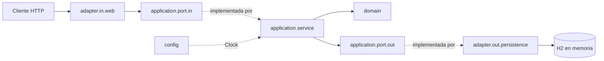

# Arquitectura

> **Fuentes:** [`specs/architecture/architecture.md`](../../specs/architecture/architecture.md),
> [`specs/architecture/tech-stack.md`](../../specs/architecture/tech-stack.md),
> [ADR-0001](../../specs/adr/0001-arquitectura-hexagonal.md),
> [ADR-0005](../../specs/adr/0005-base-de-datos-h2.md),
> [ADR-0006](../../specs/adr/0006-spring-boot-4.md) y el paquete
> `src/main/java/pe/edu/galaxy/training/java/sdd/gimnasio`.

## Estilo

Monolito con **arquitectura hexagonal** (puertos y adaptadores). El objetivo es probar las reglas
del gimnasio sin servidor ni base de datos y poder cambiar el contrato REST o la persistencia sin
tocar el dominio (ADR-0001).

## Capas



| Capa | Qué hace | Clases principales |
| :--- | :--- | :--- |
| `domain` | Modelo, invariantes y excepciones. Java puro. | `Socio`, `Clase`, `Reserva`, `Dni`, `Email`, `*Id`, enums, `*Exception` |
| `application.port.in` | Contrato de los casos de uso y sus modelos (`record`). | `*UseCase`, `*Command`, `*Query`, `*Result` |
| `application.port.out` | Lo que la aplicación necesita de la persistencia. | `SocioPersistencePort`, `ClasePersistencePort`, `ReservaPersistencePort` |
| `application.service` | Un servicio por caso de uso; orquesta y valida reglas que necesitan otros agregados. | `RegistrarSocioService`, `CrearClaseService`, `ReservarPlazaService`, `CancelarReservaService`, `ConsultarReservasService`, `ConsultarDisponibilidadService` |
| `adapter.in.web` | Traduce HTTP ↔ Command/Result y excepciones → `ErrorResponse`. | `SocioController`, `ClaseController`, `ReservaController`, `*WebMapper`, `GlobalExceptionHandler` |
| `adapter.out.persistence` | Implementa los puertos de salida con Spring Data JPA. | `*PersistenceAdapter`, `*JpaEntity`, `*PersistenceMapper`, `SpringData*Jpa` |
| `config` | Composition root. | `ClockConfiguration` |

Las interfaces que implementa `adapter.in.web` (`SociosApi`, `ClasesApi`, `ReservasApi`) se generan a partir del
contrato; la configuración del generador está documentada en
[`specs/resources/plugins.md`](../../specs/resources/plugins.md).

**Regla de dependencia** (tabla completa en [`architecture.md` §2](../../specs/architecture/architecture.md#2-capas-y-regla-de-dependencia)):

- `domain` no depende de nada (ni Spring, ni JPA, ni HTTP).
- El controlador solo conoce las interfaces `*UseCase`, nunca los servicios.
- El servicio solo conoce los `*PersistencePort`, nunca el adaptador JPA.
- `adapter.in.web` solo usa del dominio sus excepciones y enums.

## Modelos por frontera

El dominio nunca sale de `application` ([`architecture.md` §3](../../specs/architecture/architecture.md#3-modelos-de-datos-por-frontera-dto)):

```text
*Request (generado) → *WebMapper → *Command/*Query → *Service → dominio
dominio → *Result → *WebMapper → *Response (generado)
dominio ↔ *PersistenceMapper ↔ *JpaEntity
```

- Los `*Request`/`*Response` los genera openapi-generator desde el contrato en
  `adapter.in.web.generated`. Cada controlador implementa la interfaz de su tag
  (`SociosApi`, `ClasesApi`, `ReservasApi`).
- Commands, Queries y Results usan los enums del dominio. La conversión al enum del contrato
  (`valueOf(name())`) y de `Instant` a `OffsetDateTime` en UTC ocurre solo en los `*WebMapper`.

## Puertos

| Puerto de entrada | Operación | Servicio |
| :--- | :--- | :--- |
| `RegistrarSocioUseCase` | `registrar(RegistrarSocioCommand): SocioResult` | `RegistrarSocioService` |
| `CrearClaseUseCase` | `crear(CrearClaseCommand): ClaseResult` | `CrearClaseService` |
| `ReservarPlazaUseCase` | `reservar(ReservarPlazaCommand): ReservaResult` | `ReservarPlazaService` |
| `CancelarReservaUseCase` | `cancelar(CancelarReservaCommand): ReservaResult` | `CancelarReservaService` |
| `ConsultarReservasUseCase` | `consultar(ConsultarReservasQuery): ReservaPageResult` | `ConsultarReservasService` |
| `ConsultarDisponibilidadUseCase` | `consultar(ConsultarDisponibilidadQuery): DisponibilidadResult` | `ConsultarDisponibilidadService` |

Los puertos de salida y sus operaciones están en [`architecture.md` §4](../../specs/architecture/architecture.md#4-puertos).
Ninguno ofrece borrado, de modo que una reserva cancelada se conserva (INV-15).

## Transacciones y tiempo

- Los servicios son `@Transactional`; los de consulta, `readOnly = true`.
  `spring.jpa.open-in-view=false`, así que la transacción termina en `application`.
- El tiempo se inyecta como `java.time.Clock` (`ClockConfiguration`), lo que permite fijarlo en las pruebas.

## Persistencia

- H2 en memoria (`jdbc:h2:mem:gimnasio`), esquema generado desde las entidades (`create-drop`). Los datos
  se pierden al reiniciar (ADR-0005).
- Tablas `socios`, `clases` y `reservas`. `socios` tiene las restricciones únicas `uk_socios_dni` y
  `uk_socios_email`, que respaldan INV-02 e INV-03; el adaptador las traduce a `DniDuplicadoException`
  y `EmailDuplicadoException`.
- `reservas` referencia socio y clase por id, igual que el agregado `Reserva`. El solapamiento
  (INV-12) se consulta con un JPQL que une `reservas` con `clases` por la fecha de inicio.

## Stack

Java 25, Spring Boot 4.1.x (Web MVC, Validation, Data JPA), H2, Maven Wrapper, OpenAPI 3.0.3,
openapi-generator 7.22 y springdoc-openapi 3.x. Detalle en
[`tech-stack.md`](../../specs/architecture/tech-stack.md); versiones exactas en `pom.xml`.

| URL de desarrollo | Uso |
| :--- | :--- |
| `/swagger-ui.html` | Swagger UI con el contrato autoritativo (`/gimnasio-openapi.yaml`, copiado desde `specs/api/` al compilar). |
| `/h2-console` | Consola H2, solo desarrollo. |

## Flujo de ejemplo

El diagrama de secuencia completo de `reservarPlaza` está en
[`architecture.md` §6](../../specs/architecture/architecture.md#6-flujo-de-ejemplo-reservar-plaza-us03);
su resumen está en [operaciones/reservarPlaza.md](operaciones/reservarPlaza.md). Los diagramas de secuencia de
las seis operaciones y el de componentes están en [diagramas.md](diagramas.md).
