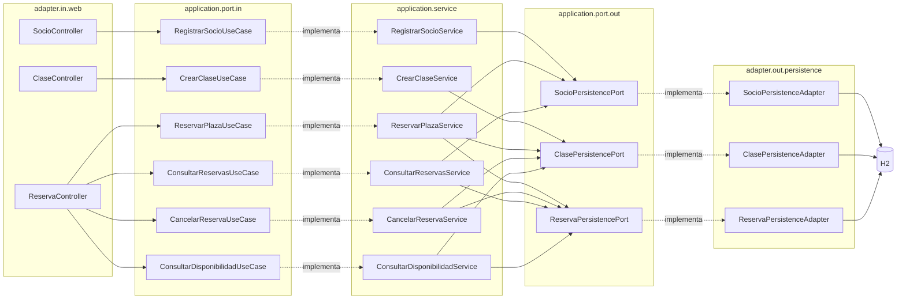
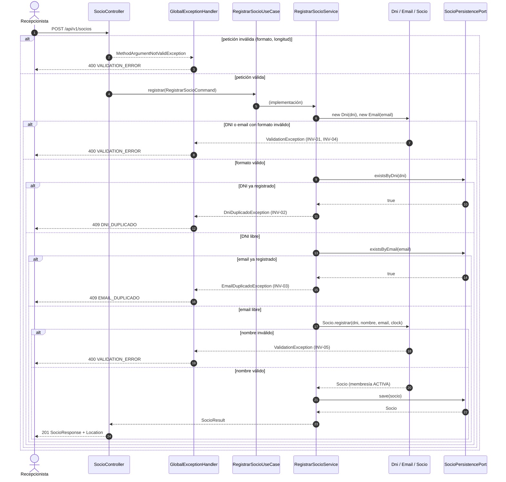
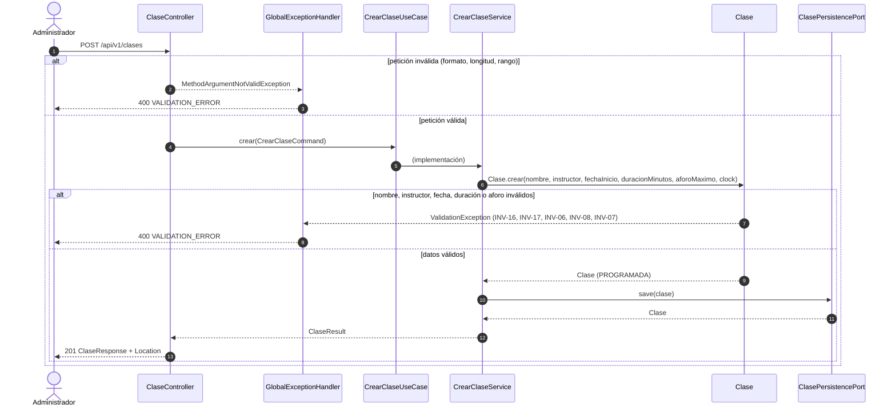
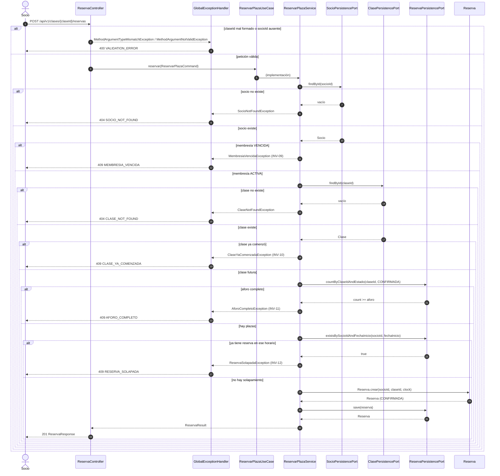
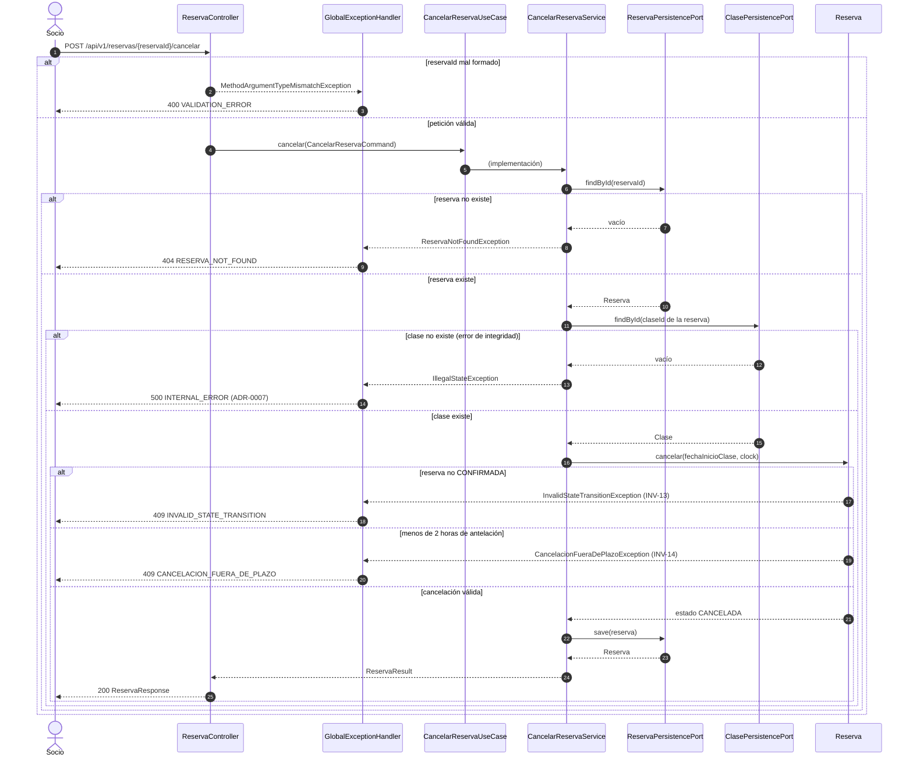
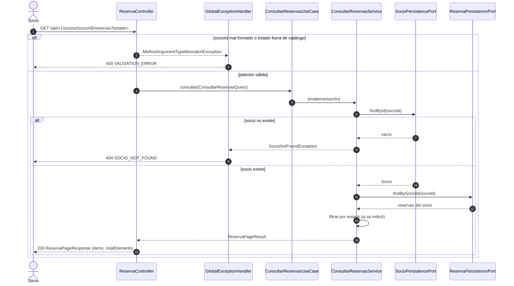
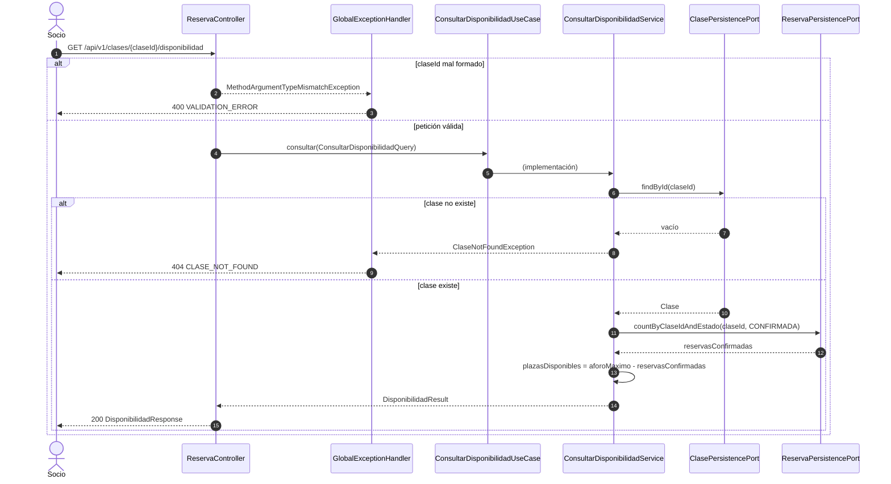

# Diagramas

> **Fuentes:** [`architecture.md` §2 y §6](../../specs/architecture/architecture.md#6-flujo-de-ejemplo-reservar-plaza-us03),
> [`gimnasio-openapi.yaml`](../../specs/api/gimnasio-openapi.yaml),
> [ADR-0004](../../specs/adr/0004-codigos-de-error.md), [ADR-0007](../../specs/adr/0007-error-interno-generico.md),
> las historias de usuario (actores) y el código de los `*Controller`, `*Service`, `*PersistencePort`,
> `Socio`, `Clase` y `Reserva`.

Un diagrama de secuencia por `operationId`, en el estilo del flujo de ejemplo de
[`architecture.md` §6](../../specs/architecture/architecture.md#6-flujo-de-ejemplo-reservar-plaza-us03), y un
diagrama de componentes adaptador → puerto → servicio. Complementan [arquitectura.md](arquitectura.md) (capas y
puertos) y [dominio.md](dominio.md) (invariantes).

> **Si hay contradicción, manda la spec.** Estos diagramas se derivan de las specs y del código; no añaden reglas.
> Una diferencia entre un diagrama y la spec se anota en [`sync-report.md`](../sync-report.md).

**Convenciones de los diagramas:**

- `UC` es la interfaz del caso de uso (`application.port.in`) y `SVC` su implementación.
- `H` es `GlobalExceptionHandler`: traduce cada excepción al HTTP y `code` de ADR-0004. Una excepción no
  mapeada responde `500 INTERNAL_ERROR` (ADR-0007).
- La primera rama `alt` de cada diagrama es la validación de la petición antes de llegar al controlador: los DTO
  generados llevan anotaciones de Bean Validation, y Spring convierte los parámetros de ruta y consulta
  (UUID, enums). Si falla, responde `400 VALIDATION_ERROR`.
- Las comprobaciones aparecen en el mismo orden que en el código.

| Operación | Historia | Actor | Diagrama |
| :--- | :--- | :--- | :--- |
| `registrarSocio` | US01 | Recepcionista | [ver](#registrarsocio-us01) |
| `crearClase` | US02 | Administrador | [ver](#crearclase-us02) |
| `reservarPlaza` | US03 | Socio | [ver](#reservarplaza-us03) |
| `cancelarReserva` | US04 | Socio | [ver](#cancelarreserva-us04) |
| `consultarReservas` | US05 | Socio | [ver](#consultarreservas-us05) |
| `consultarDisponibilidad` | US05 | Socio | [ver](#consultardisponibilidad-us05) |

## Componentes: adaptador → puerto → servicio

Las flechas continuas son "usa" y las punteadas "implementa". Los controladores solo conocen las interfaces
`*UseCase`, y los servicios solo los `*PersistencePort` (regla de dependencia de
[`architecture.md` §2](../../specs/architecture/architecture.md#2-capas-y-regla-de-dependencia)). Todos los
controladores comparten `GlobalExceptionHandler`, y todos los servicios que fijan fechas reciben el `Clock` de
`ClockConfiguration`.

## registrarSocio (US01)

`POST /api/v1/socios` → `201 SocioResponse` con `Location`.

Si dos registros simultáneos superan `existsByDni`/`existsByEmail`, la restricción única de la base de datos
hace fallar `save`, y `SocioPersistenceAdapter` la traduce a `DniDuplicadoException` o
`EmailDuplicadoException` (409).

## crearClase (US02)

`POST /api/v1/clases` → `201 ClaseResponse` con `Location`.

`Clase.crear` comprueba las invariantes en el orden del diagrama: nombre (INV-16), instructor (INV-17), fecha
futura (INV-06), duración (INV-08) y aforo (INV-07).

## reservarPlaza (US03)

`POST /api/v1/clases/{claseId}/reservas` → `201 ReservaResponse` (sin `Location`).

Es el flujo de [`architecture.md` §6](../../specs/architecture/architecture.md#6-flujo-de-ejemplo-reservar-plaza-us03),
con la validación de la petición añadida al principio.

INV-09 a INV-12 viven en el servicio porque necesitan el socio, la clase y otras reservas; `Reserva` solo se
crea en estado `CONFIRMADA`.

## cancelarReserva (US04)

`POST /api/v1/reservas/{reservaId}/cancelar` → `200 ReservaResponse` (acción de negocio, ADR-0002).

INV-13 e INV-14 viven en `Reserva.cancelar`; el servicio solo aporta la fecha de inicio de la clase, que la
reserva no conoce. La reserva cancelada se guarda, nunca se borra (INV-15), y `fechaReserva` no cambia.

## consultarReservas (US05)

`GET /api/v1/socios/{socioId}/reservas?estado=` → `200 ReservaPageResponse`.

Es de solo lectura y no tiene invariantes propias. Sin `estado`, devuelve todas las reservas del socio.

## consultarDisponibilidad (US05)

`GET /api/v1/clases/{claseId}/disponibilidad` → `200 DisponibilidadResponse`.

Cuenta solo las reservas `CONFIRMADA`, igual que la comprobación de aforo de `reservarPlaza` (INV-11).
