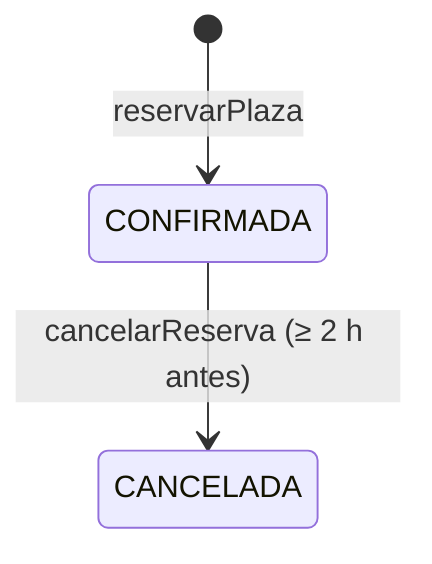

# Dominio

> **Fuentes:** [`specs/architecture/domain-model.md`](../../specs/architecture/domain-model.md),
> [`specs/domain/lifecycle.md`](../../specs/domain/lifecycle.md),
> [`specs/domain/catalogs.md`](../../specs/domain/catalogs.md),
> [`specs/requirements/functional.md`](../../specs/requirements/functional.md) y el paquete `domain`.

## Glosario

| Término | Código | Qué es |
| :--- | :--- | :--- |
| Socio | `Socio` | Persona registrada en el gimnasio. Agregado raíz. |
| Clase | `Clase` | Sesión con horario, instructor y aforo. Agregado raíz. |
| Reserva | `Reserva` | Plaza de un socio en una clase. Agregado raíz; referencia socio y clase por id. |
| Identificadores | `SocioId`, `ClaseId`, `ReservaId` | Value Objects sobre un UUID generado por el sistema (ADR-0003). |
| DNI | `Dni` | Value Object de 8 dígitos. Único. |
| Email | `Email` | Value Object con formato de email. Único. |
| Membresía | `Membresia` | Estado de la suscripción: `ACTIVA` o `VENCIDA`. |
| Aforo | `aforoMaximo` | Número máximo de plazas de una clase. |

Glosario completo en [`domain-model.md` §1](../../specs/architecture/domain-model.md#1-glosario-lenguaje-ubicuo).

## Agregados

| Agregado | Fábrica | Otras operaciones | Notas |
| :--- | :--- | :--- | :--- |
| `Socio` | `registrar(dni, nombre, email, clock)` → membresía `ACTIVA` | `restore(...)` | Todos sus campos son finales: en V1 la membresía no cambia. |
| `Clase` | `crear(nombre, instructor, fechaInicio, duracionMinutos, aforoMaximo, clock)` → `PROGRAMADA` | `restore(...)` | |
| `Reserva` | `crear(socioId, claseId, clock)` → `CONFIRMADA` | `cancelar(fechaInicioClase, clock)`, `restore(...)` | `cancelar` no modifica `fechaReserva`. |

`restore(...)` reconstruye entidades guardadas sin aplicar reglas; solo lo usan los adaptadores de persistencia.
Las operaciones que fijan fechas reciben un `Clock`.

## Estados

| Entidad | Estados | Transiciones | En V1 |
| :--- | :--- | :--- | :--- |
| Membresía | `ACTIVA`, `VENCIDA` | — | Se asigna `ACTIVA` al registrar. `VENCIDA` solo es asignable con `Socio.restore` o en la BD. |
| Clase | `PROGRAMADA`, `CANCELADA`, `COMPLETADA` | `PROGRAMADA → CANCELADA` (administrador), `PROGRAMADA → COMPLETADA` (al pasar la fecha) | Solo se crea en `PROGRAMADA`; las transiciones no tienen operación. |
| Reserva | `CONFIRMADA`, `CANCELADA` | `CONFIRMADA → CANCELADA` (socio, ≥ 2 h antes) | Implementada en `Reserva.cancelar`. |

Fuente: [`lifecycle.md`](../../specs/domain/lifecycle.md). Los enums `Membresia`, `EstadoClase` y
`EstadoReserva` tienen los mismos valores y el mismo orden que [`catalogs.md`](../../specs/domain/catalogs.md).

## Invariantes

| ID | Regla | Dónde se garantiza | Error | CA |
| :--- | :--- | :--- | :--- | :--- |
| INV-01 | DNI de 8 dígitos | `Dni` | `VALIDATION_ERROR` | US01 CA-03 |
| INV-02 | DNI único | `RegistrarSocioService` + `uk_socios_dni` | `DNI_DUPLICADO` | US01 CA-02 |
| INV-03 | Email único | `RegistrarSocioService` + `uk_socios_email` | `EMAIL_DUPLICADO` | US01 CA-04 |
| INV-04 | Email con formato válido | `Email` | `VALIDATION_ERROR` | US01 CA-05 |
| INV-05 | Nombre del socio: 3–100, sin espacios en los extremos | `Socio.registrar` | `VALIDATION_ERROR` | US01 CA-06 |
| INV-06 | Fecha de inicio de la clase futura | `Clase.crear` | `VALIDATION_ERROR` | US02 CA-02 |
| INV-07 | Aforo 1–50 | `Clase.crear` | `VALIDATION_ERROR` | US02 CA-03 |
| INV-08 | Duración 1–180 min | `Clase.crear` | `VALIDATION_ERROR` | US02 CA-04 |
| INV-09 | Solo reserva un socio con membresía `ACTIVA` | `ReservarPlazaService` | `MEMBRESIA_VENCIDA` | US03 CA-02 |
| INV-10 | No se reserva una clase que ya comenzó | `ReservarPlazaService` | `CLASE_YA_COMENZADA` | US03 CA-05 |
| INV-11 | No se supera el aforo | `ReservarPlazaService` | `AFORO_COMPLETO` | US03 CA-03 |
| INV-12 | Sin dos reservas activas del socio a la misma hora | `ReservarPlazaService` | `RESERVA_SOLAPADA` | US03 CA-04 |
| INV-13 | Solo se cancela una reserva `CONFIRMADA` | `Reserva.cancelar` | `INVALID_STATE_TRANSITION` | US04 CA-03 |
| INV-14 | Cancelación con ≥ 2 h de antelación | `Reserva.cancelar` | `CANCELACION_FUERA_DE_PLAZO` | US04 CA-02 |
| INV-15 | Una reserva cancelada no se elimina | Ningún puerto ofrece borrado | — | — |
| INV-16 | Nombre de la clase: 3–100, sin espacios en los extremos | `Clase.crear` | `VALIDATION_ERROR` | US02 CA-05 |
| INV-17 | Instructor: 3–100, sin espacios en los extremos | `Clase.crear` | `VALIDATION_ERROR` | US02 CA-06 |

Detalle y fuentes en [`domain-model.md` §3](../../specs/architecture/domain-model.md#3-invariantes).

**Límites aplicados en el código:**

- INV-06 e INV-10: una fecha igual a "ahora" ya no es futura.
- INV-14: exactamente 2 horas de antelación se admite.
- INV-11 e INV-12 solo cuentan reservas `CONFIRMADA`.

## Por qué algunas reglas están en el servicio

- INV-02 e INV-03 necesitan conocer a los demás socios, algo que un agregado no puede saber por sí solo.
- INV-09 a INV-12 necesitan el socio, la clase y otras reservas, así que viven en `ReservarPlazaService`.
- El dominio no tiene puertos ni conoce la persistencia.

Ver [`domain-model.md` §4](../../specs/architecture/domain-model.md#4-decisiones-de-modelado).

## Excepciones

Una por cada fila de ADR-0004, todas subclases de `DomainException(message, details)`:
`ValidationException`, `DniDuplicadoException`, `EmailDuplicadoException`, `SocioNotFoundException`,
`ClaseNotFoundException`, `ReservaNotFoundException`, `MembresiaVencidaException`,
`ClaseYaComenzadaException`, `AforoCompletoException`, `ReservaSolapadaException`,
`InvalidStateTransitionException` y `CancelacionFueraDePlazoException`.

## Referencias

El registro de cambios de las specs ([`specs/CHANGELOG.md`](../../specs/CHANGELOG.md)) documenta la
evolución de las invariantes (por ejemplo, INV-16 e INV-17).
