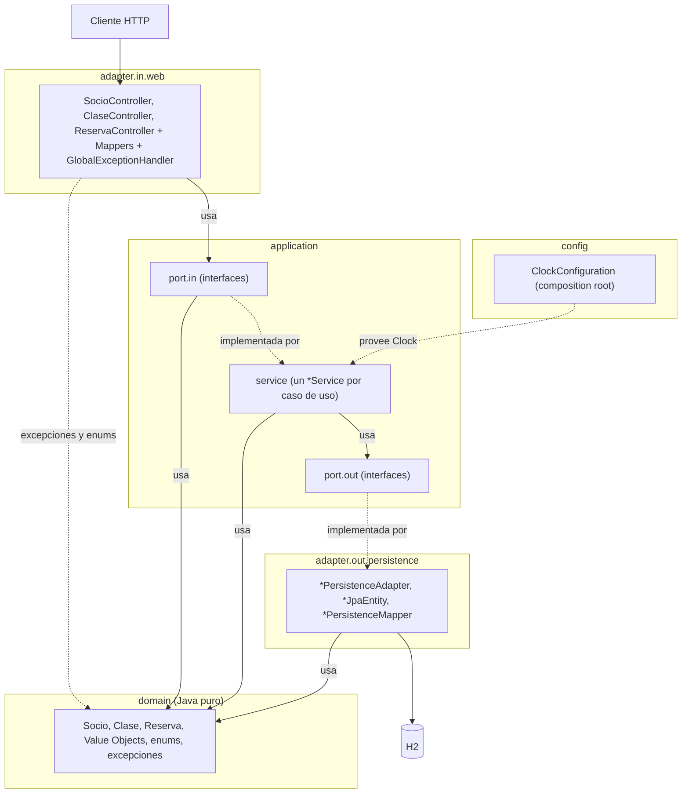
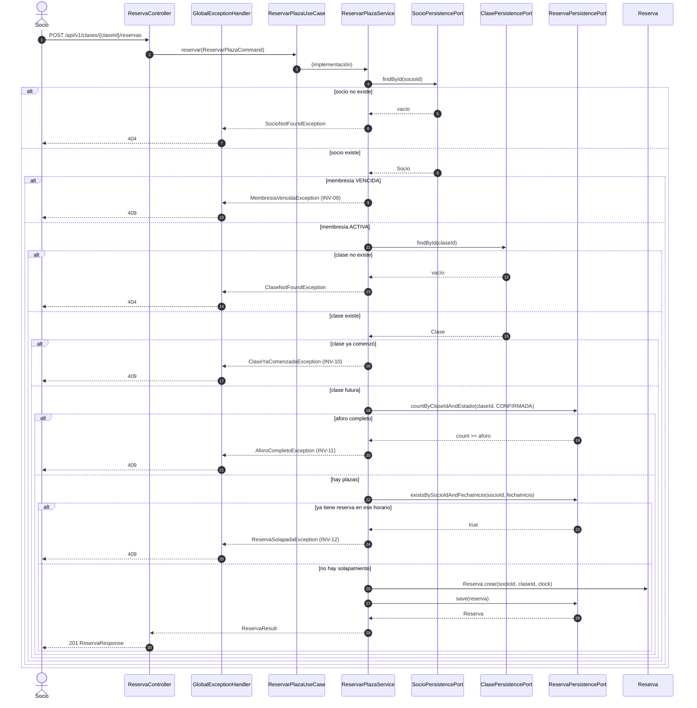

# Arquitectura - Sistema de Reservas para Gimnasio

## 1. Estilo

Aplicación única (monolito) con **arquitectura hexagonal** (puertos y adaptadores).
Justificación en `adr/0001`.

**Stack:** ver `tech-stack.md`.

## 2. Capas y regla de dependencia



| Capa / paquete | Responsabilidad | Puede depender de | Nunca depende de |
| :--- | :--- | :--- | :--- |
| `domain` | Modelo, reglas e invariantes (INV-01 a INV-17), excepciones de dominio. | nada | Spring, JPA, HTTP, `application`, `adapter` |
| `application.port.in` | Interfaces de casos de uso + Commands, Queries y Results. | `domain` | `adapter` |
| `application.port.out` | Interfaces de lo que la aplicación necesita del exterior. | `domain` | `adapter` |
| `application.service` | Implementa `port.in`; orquesta dominio y `port.out`. | `domain`, `port.in`, `port.out` | `adapter` |
| `adapter.in.web` | HTTP: DTO web, mapeo a Command, traducción de errores. | `application.port.in`, `domain` (solo sus excepciones y enums) | `application.service`, el resto de `domain`, `adapter.out` |
| `adapter.out.persistence` | Implementa `port.out` con JPA. | `application.port.out`, `domain` | `adapter.in` |
| `config` | Ensamblaje: beans de configuración (composition root). | todas las capas | — (nadie depende de `config`) |

**Regla clave:** el controlador solo conoce las interfaces de `port.in`, nunca los servicios.
El servicio solo conoce `port.out`, nunca el adaptador JPA.

## 3. Modelos de datos por frontera (DTO)

Cada frontera tiene su propio modelo; el dominio nunca sale de la aplicación.

| Modelo | Paquete | Tipo | Propósito |
| :--- | :--- | :--- | :--- |
| `*Request`, `*Response` | `adapter.in.web` (generados) | DTO web | Forma exacta del contrato OpenAPI. |
| `*Command`, `*Query` | `application.port.in` | `record` | Entrada de casos de uso. |
| `*Result` | `application.port.in` | `record` | Salida de los casos de uso (nunca se exponen entidades de dominio). |
| `*JpaEntity` | `adapter.out.persistence` | Entidad JPA | Forma de las tablas. |

Commands y Queries usan los enums del dominio. La conversión entre los enums generados del contrato y los del dominio ocurre solo en los `*WebMapper` (`adapter.in.web`).

Los `*Request`, los `*Response`, los enums del contrato y las interfaces `SociosApi`, `ClasesApi` y `ReservasApi` se generan a partir del contrato en `adapter.in.web.generated` (fuera de `src/`, al compilar). La configuración del generador está documentada en [`resources/plugins.md`](../resources/plugins.md).

## 4. Puertos

| Puerto | Tipo | Operaciones |
| :--- | :--- | :--- |
| `RegistrarSocioUseCase` | in | `registrar(RegistrarSocioCommand): SocioResult` |
| `CrearClaseUseCase` | in | `crear(CrearClaseCommand): ClaseResult` |
| `ReservarPlazaUseCase` | in | `reservar(ReservarPlazaCommand): ReservaResult` |
| `CancelarReservaUseCase` | in | `cancelar(CancelarReservaCommand): ReservaResult` |
| `ConsultarReservasUseCase` | in | `consultar(ConsultarReservasQuery): ReservaPageResult` |
| `ConsultarDisponibilidadUseCase` | in | `consultar(ConsultarDisponibilidadQuery): DisponibilidadResult` |
| `SocioPersistencePort` | out | `save(Socio): Socio`, `findById(SocioId): Optional<Socio>`, `existsByDni(Dni): boolean`, `existsByEmail(Email): boolean` |
| `ClasePersistencePort` | out | `save(Clase): Clase`, `findById(ClaseId): Optional<Clase>` |
| `ReservaPersistencePort` | out | `save(Reserva): Reserva`, `findById(ReservaId): Optional<Reserva>`, `countByClaseIdAndEstado(ClaseId, EstadoReserva): long`, `existsBySocioIdAndFechaInicio(SocioId, Instant): boolean`, `findBySocioId(SocioId): List<Reserva>` |

Un servicio por caso de uso: cada clase se rastrea a una sola historia.

## 5. Estructura de paquetes

```text
pe.edu.galaxy.training.java.sdd.gimnasio
├── domain
│   ├── model            # Socio, Clase, Reserva, Value Objects, enums
│   └── exception        # DomainException (base), *Exception (una por fila de ADR-0004)
├── application
│   ├── port
│   │   ├── in
│   │   │   ├── usecase  # *UseCase
│   │   │   ├── command  # *Command
│   │   │   ├── query    # *Query
│   │   │   └── result   # *Result
│   │   └── out          # *PersistencePort
│   └── service          # un *Service por caso de uso
├── adapter
│   ├── in
│   │   └── web          # *Controller, *WebMapper, GlobalExceptionHandler
│   └── out
│       └── persistence  # *PersistenceAdapter, *JpaEntity, *PersistenceMapper
└── config               # ClockConfiguration
```

## 6. Flujo de ejemplo: reservar plaza (US03)



Las reglas (INV-09 a INV-12) se evalúan en el servicio de reserva; el dominio `Reserva` solo crea la reserva. Los códigos HTTP y los `code` de error están definidos en ADR-0004.