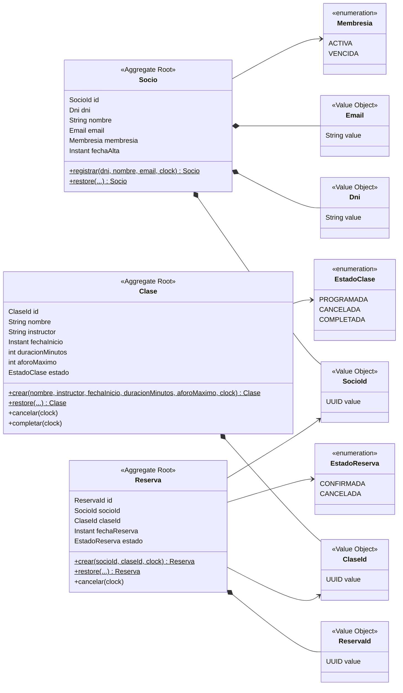

# Modelo de Dominio - Sistema de Reservas para Gimnasio

Organiza en objetos las reglas de `requirements/`, `domain/` y `user-stories/`.
No introduce reglas nuevas: si una regla no tiene fuente, primero se agrega a la spec.

## 1. Glosario (lenguaje ubicuo)

| Término de negocio | Código | Definición |
| :--- | :--- | :--- |
| Socio | `Socio` | Persona registrada en el gimnasio. Agregado principal. |
| Identificador de socio | `SocioId` | Objeto de valor que envuelve un `UUID` generado por el sistema (ADR-0003). |
| DNI | `Dni` | Documento Nacional de Identidad, formato `12345678` (8 dígitos). Único en el sistema. |
| Email | `Email` | Dirección de correo electrónico válida. Única en el sistema. |
| Membresía | `Membresia` | Estado de la suscripción del socio: `ACTIVA` o `VENCIDA`. |
| Clase | `Clase` | Sesión de entrenamiento con horario, instructor y aforo. Agregado principal. |
| Identificador de clase | `ClaseId` | Objeto de valor que envuelve un `UUID` generado por el sistema (ADR-0003). |
| Reserva | `Reserva` | Vínculo entre un socio y una clase en un horario determinado. Agregado principal. |
| Identificador de reserva | `ReservaId` | Objeto de valor que envuelve un `UUID` generado por el sistema (ADR-0003). |
| Aforo | `Aforo` | Número máximo de plazas disponibles en una clase. |

## 2. Diagrama de clases

## 3. Invariantes

| ID | Regla | Dónde se garantiza | Fuente | Criterios |
| :--- | :--- | :--- | :--- | :--- |
| INV-01 | El DNI tiene formato de 8 dígitos. | `Dni` (al construirse) | RF-01 | US01 CA-03 |
| INV-02 | El DNI es único en el sistema. | `RegistrarSocioService` (application), consultando `SocioPersistencePort.existsByDni`; respaldada por una restricción única en BD | RF-01 | US01 CA-02 |
| INV-03 | El email es único en el sistema. | `RegistrarSocioService` (application), consultando `SocioPersistencePort.existsByEmail`; respaldada por una restricción única en BD | RF-01 | US01 CA-04 |
| INV-04 | El email tiene formato válido. | `Email` (al construirse) | RF-01 | US01 CA-05 |
| INV-05 | El nombre del socio tiene entre 3 y 100 caracteres, sin espacios al inicio ni al final. | `Socio` | RF-01 | — |
| INV-06 | La fecha de inicio de una clase debe ser futura. | `Clase.crear()` | RF-02 | US02 CA-02 |
| INV-07 | El aforo máximo está entre 1 y 50. | `Clase.crear()` | RF-02 | US02 CA-03 |
| INV-08 | La duración de la clase está entre 1 y 180 minutos. | `Clase.crear()` | RF-02 | US02 CA-04 |
| INV-09 | Un socio solo puede reservar si su membresía está `ACTIVA`. | `ReservarPlazaService` (application), consultando el estado del socio | RF-03 | US03 CA-02 |
| INV-10 | No se puede reservar en una clase que ya comenzó. | `ReservarPlazaService` (application), comparando fechas con el `Clock` | RF-03 | US03 CA-05 |
| INV-11 | No se puede superar el aforo máximo de una clase. | `ReservarPlazaService` (application), consultando `ReservaPersistencePort.countByClaseIdAndEstado` | RF-03 | US03 CA-03 |
| INV-12 | Un socio no puede tener dos reservas activas en el mismo horario. | `ReservarPlazaService` (application), consultando `ReservaPersistencePort.existsBySocioIdAndFechaInicio` | RF-03 | US03 CA-04 |
| INV-13 | Solo se puede cancelar una reserva `CONFIRMADA`. | `Reserva.cancelar()` | RF-04 | US04 CA-03 |
| INV-14 | Solo se puede cancelar con al menos 2 horas de antelación. | `Reserva.cancelar()` | RF-04 | US04 CA-02 |
| INV-15 | Una reserva cancelada no se elimina. | No existe operación de borrado | RF-04 | — |

## 4. Decisiones de modelado

- **La membresía es un enum y no un Value Object**: el catálogo es cerrado; si fuera administrable, sería una entidad.
- **Cambiar la membresía queda fuera del alcance de V1**: ningún requisito, historia de usuario ni regla de ciclo de vida define cómo ni cuándo cambia la membresía de un socio, por lo que `Socio` no expone un método `cambiarMembresia`. Si se necesita, primero se especifica (requisito, historia con criterios de aceptación y transiciones permitidas) y después se agrega al modelo.
- La unicidad del DNI y del email (INV-02, INV-03) no puede validarla `Socio` solo: un objeto no conoce a los demás socios. Se valida en el servicio de aplicación, consultando el puerto de salida.
- El aforo y el solapamiento de horarios (INV-11, INV-12) se validan en el servicio de reserva: requieren conocer otras reservas, algo que el agregado `Reserva` no puede hacer por sí solo.
- El dominio no contiene puertos ni conoce la persistencia: solo modelo, reglas y excepciones de dominio. Los puertos se definen en application (ver `architecture.md`).
- Reconstitución: `Socio.restore(...)`, `Clase.restore(...)` y `Reserva.restore(...)` reconstruyen entidades ya guardadas sin aplicar reglas de transición. Los usan solo los adaptadores de persistencia.
- Tiempo: los métodos que modifican entidades reciben un `java.time.Clock` para fijar las fechas, de modo que las pruebas controlan el tiempo.